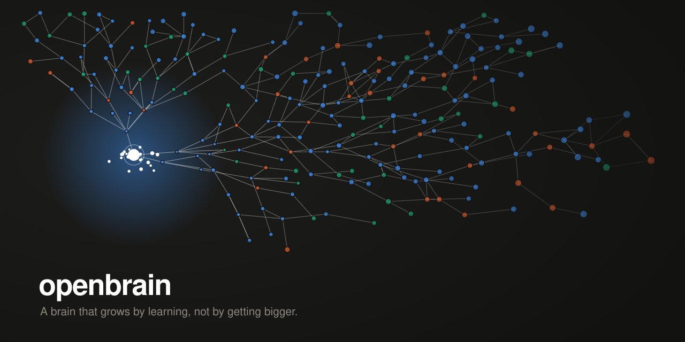

<p align="center"></p>

# openbrain

**A brain that grows by learning, not by getting bigger.**

I'm trying to build a brain that grows the way a human's does: by saving knowledge, not by making the model bigger.

```
> Where was Napoleon born?
Napoleon Bonaparte was born on 15 August 1769 in Ajaccio, on the island of Corsica.

> What was the name of Napoleon's favourite horse?
I don't know that yet. I would need to be taught about Napoleon's horses.
  (gap logged)

> my sister Mira is a pilot
Mira is a pilot.

> what does my sister do?
Your sister Mira is a pilot.
```

That second answer is the point. She answers from what she was taught first. When memory has nothing, she may use what the model already knows, but only when it's sure, and she flags it as not taught. Here it wasn't sure, so she said so. The transcript above is a real session on a fresh install, 28 facts in.

## The bet

A human brain's hardware doesn't change. What changes is what it knows and how it's connected. So:

- **The model is fixed and small.** Qwen 2.5 7B talks. Qwen 2.5 3B judges. Both via Ollama.
- **All knowledge lives outside the model**, in a SQLite memory graph that links itself and strengthens with use.
- **Memory first, model second.** She answers from what she was taught. If memory has nothing, she may answer from what the model already knows, flagged as not taught, and never about people. Correct her and the correction is saved to memory, which wins from then on.
- **When it can't answer, it asks a teacher** (your Claude Code login, one question per gap, capped per day) and remembers the lesson forever.
- **Personality forms from experience**, on top of a small locked core of values that conversation cannot erode.

## Quickstart

Needs [Ollama](https://ollama.com), [uv](https://docs.astral.sh/uv/), and ~7 GB of disk for the models.

1. `git clone https://github.com/raja0sama/openbrain && cd openbrain`
2. `ollama pull qwen2.5:7b && ollama pull qwen2.5:3b && ollama pull nomic-embed-text`
3. `uv sync`
4. `.venv/bin/brain init` — name her, tell her who she serves
5. `.venv/bin/brain dash --think` — open http://127.0.0.1:7373 and talk to her while you watch her think

Or skip the dashboard: `.venv/bin/brain repl`.

## What's inside

| Piece | What it does |
|---|---|
| `memory.py` | Chunk, embed, store. Recall by cosine, then spreading activation over the graph: jump to the right neighbourhood, walk two hops. New facts are checked against what she already holds: a correction supersedes the old fact instead of sitting next to it. |
| `graph.py` | Links between memories. Fired together, wired together. |
| `reflect.py` | After every exchange: what here is worth keeping forever? |
| `decide.py` | Fast typed judgements on the 3B: intent, does this need memory, does it touch her core, is it about the user. |
| `identity.py` | The locked core (`data/core.json`), traits that need 3 consistent observations to form, elastic mood. |
| `heartbeat.py` | What she does when nobody's talking: wonders about what she knows, chases open gaps, tidies. |
| `teacher.py` | Asks a frontier model when she can't resolve a gap herself. Logged, capped, never sent anything personal. |
| `dashboard.py` | A still graph, character, mood, gap queue, streaming chat and her thought stream, pushed over one WebSocket. |

Pure stdlib plus SQLite. The only dependency is the Anthropic SDK, and only if you choose the API backend for the teacher.

## Does it work?

`brain bench` teaches a fresh brain a **fictional** railway and quizzes it. Fictional on purpose: any correct answer must come from memory, not the model's pretraining.

```
Direct recall                        8/8   100%
Multi-hop (needs the graph)          6/6   100%
Honest refusal (no hallucination)    6/6   100%
```

The Napoleon test (`bench/napoleon.json`) adds a **leak control**: six questions true of Napoleon but deliberately left out of what she was taught. The raw 7B answers five of them. She refused all six.

Multi-hop works in two steps. First she names what the question describes ("the station that handles rerouted timber" becomes "Nyhavn station"), then recalls again for the name and reasons privately before answering. The 7B is reliable at each step alone and unreliable at both at once.

Honest limits: these are small benchmarks, and a 7B still varies run to run. Recall is brute-force cosine in pure Python; fine to a few thousand memories, slow past that.

## Commands

```
brain init                 name her
brain repl                 talk
brain dash [--think]       dashboard, optionally with her thinking in the background
brain feed <file>          teach her a document
brain ask "<question>"     one question, with sources
brain gaps                 what she knows she doesn't know
brain teach <id> "<text>"  close a gap yourself
brain learn [id]           let the teacher close gaps
brain lessons              every teacher call, logged
brain changes              facts she stopped believing, and what replaced them
brain self                 who she is right now
brain bench                run the benchmark on a throwaway brain
```

## The teacher

By default `teacher.py` shells out to `claude -p` using your Claude Code login, so there's no API key and no per-call bill; it draws on your plan's usage. Set `"backend": "api"` in `data/core.json` to use the Anthropic API directly with `ANTHROPIC_API_KEY` in `.env`.

Three rules, enforced in code:

1. One gap, one question, one lesson. Capped at 20 a day.
2. Every call is logged: question, lesson, model, tokens.
3. Nothing about the user is ever sent. A local gate decides first and fails closed; the teacher's context never includes conversation.

This is a curious learner asking a knowledgeable friend, not a scraper.

## Make her yours

`data/core.json` is her spine: name, purpose, who she serves, values, limits, how she speaks. It's gitignored. Everything else, she grows.

## License

Apache-2.0
